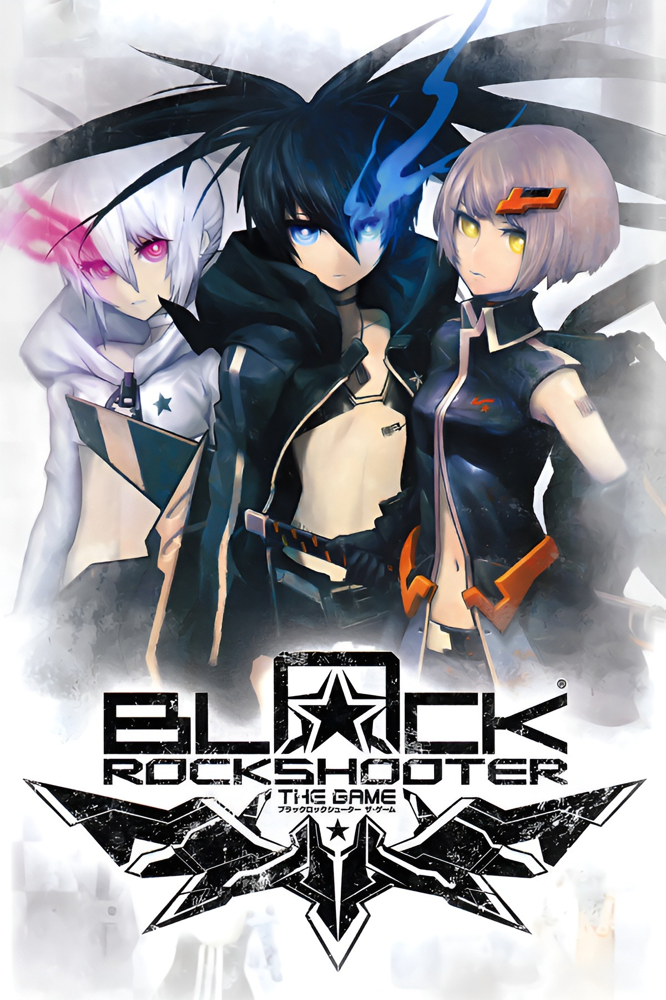

# BLACK★ROCK SHOOTER THE GAME 한국어 패치 v1.0.1

<p align="center">
  
</p>

> 게임 이미지와 로고의 권리는 각 권리자에게 있습니다. 자세한 내용은 [제3자 자산 및 권리 고지](ASSET_NOTICE.md)를 확인하십시오.

대상은 미국 PSN판 `NPUH10126`입니다. 배포본에는 게임 ISO가 들어 있지 않으며,
사용자가 보유한 지원 원본으로 새 한국어판 ISO를 생성합니다. 원본 ISO는 수정하지 않습니다.

## v1.0.1 긴급 수정

- 2지역 3번째 미션에서 도입 컷씬 뒤 진행이 정지하거나 크래시하던 문제를 수정했습니다.
- 원인은 번역된 BSCR 문자열 재배치로 후속 바이트코드 주소가 달라진 것이었습니다.
- 모든 BSCR 번역을 원본 슬롯 안에 넣고, 남는 바이트는 원본 NUL 앞에서 공백으로 채웁니다.
- 사용자 실행 검증으로 **2-3 통과**를 확인한 정확한 ISO 해시를 배포 대상으로 사용합니다.
- 3지역 2번째 미션 포탈 관련 파일은 정적 구조 검사를 통과했지만, 런타임 확인은 아직 보류입니다.

## 검증 상태

- 빌더 델타 왕복 적용: 통과
- Windows PowerShell 설치 스크립트 왕복 적용: 통과
- ISO 교체 파일 검증: `641/641` 통과
- BSCR: `88/88` 파일 크기·구조·코드 꼬리·허용 슬롯 밖 바이트 동일
- BSCR 문자열 포인터 이동: `0`, 주소 변경: `0`, 총 크기 증가: `0`
- PPSSPP 사용자 실행 검증: 2지역 3번째 미션 통과
- 3지역 2번째 미션 포탈 런타임 검증: 보류

## 지원 원본

- 크기: `1,360,363,520`바이트
- SHA-256: `4735b0d0f59d480991fd8cf034e5b0f2d98798cec275ab4162df09b8a6d23f0e`

크기와 SHA-256이 모두 일치하지 않으면 설치 스크립트가 작업을 거부합니다.

## 설치

원본 ISO를 `Apply-KoreanPatch.bat` 위에 끌어다 놓거나, 이 폴더에서 다음을 실행합니다.

```powershell
powershell.exe -NoProfile -ExecutionPolicy Bypass -File ".\Apply-KoreanPatch.ps1" -SourceIso "<원본_ISO_경로>"
```

출력 경로를 생략하면 원본과 같은 폴더에 `_Korean_v1.0.1.iso`가 생성됩니다.

```powershell
powershell.exe -NoProfile -ExecutionPolicy Bypass -File ".\Apply-KoreanPatch.ps1" -SourceIso "<원본_ISO_경로>" -OutputIso "<출력_ISO_경로>"
```

완성본 검증값:

- 크기: `1,378,271,232`바이트
- SHA-256: `525b5d2b7d8f4723be25b026e72b69d07d30c2cf84d8a48235577ca3728fc92a`

## 패치 범위와 표기

- 대사, 컷씬 자막, 아이템명, 시스템 문구를 반영했습니다.
- `General` 직함은 문맥에 맞게 `총독`으로 통일했습니다.
- 통신 발신 코드 `MEFE / MZMA / SZZU / CKRY / LLWO / XNFE / SAHA`는 라틴 표기를 유지합니다.
- 이번 v1.0.1은 사용자가 2-3 통과를 확인한 정확한 긴급 수정본입니다. 일반 에일리언 이름의
  한국어 표기 보강은 별도 런타임 후보에서 검증 중이며 이 정확한 긴급 수정본에는 섞지 않았습니다.
- ★MENU의 고정 그래픽 메뉴 라벨은 영어를 유지합니다.

## 선택 설치: PPSSPP HD UI 팩

`BRS_Korean_HD_UI_Pack.zip`은 PPSSPP 전용 선택 설치 팩입니다. 압축 안의 `PSP` 폴더를
PPSSPP 메모리 스틱 루트에 합친 뒤 **Replace Textures(텍스처 교체)** 를 켜십시오.
이 팩은 표시 전용이며 ISO 자체를 바꾸지 않습니다.

## 복원

설치 과정은 원본을 덮어쓰지 않습니다. `Restore-Original.bat`은 패치가 만든 ISO가
패치 헤더의 크기와 SHA-256에 정확히 일치할 때만 그 출력물을 삭제합니다.

## 무결성

```powershell
Get-Content ".\CHECKSUMS.sha256"
Get-FileHash ".\BRS_Korean_NPUH10126_v1.0.1.brspatch" -Algorithm SHA256
```

패치 파일:

- 크기: `91,464,923`바이트
- SHA-256: `9b00259384529a3222fffc14da432b1bb62692f143100cf22f6a98374c18136f`
- BRSPATCH 레코드: `4,084`개

상세 검증 결과는 `REPORTS/README.md`와 `RELEASE_REPORT.json`을 확인하십시오.
